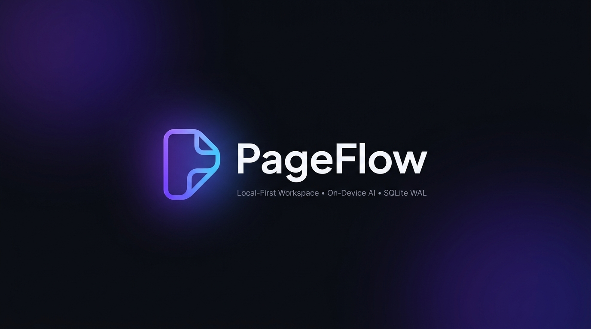
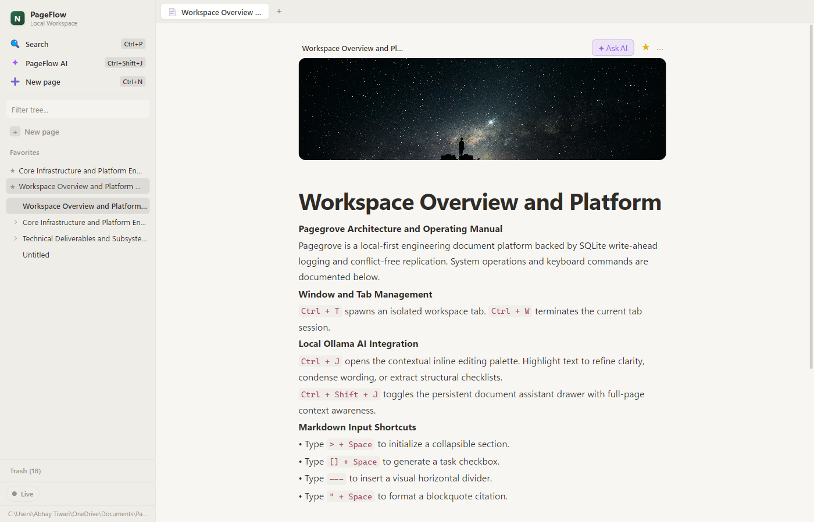
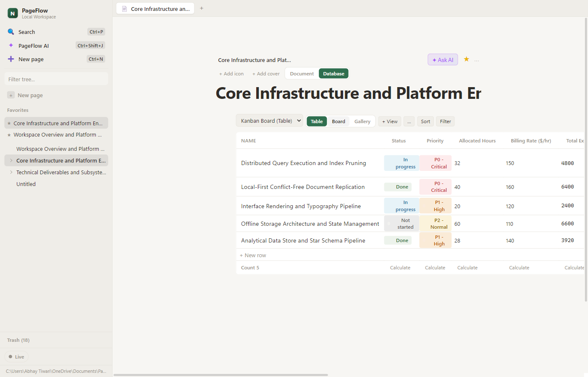
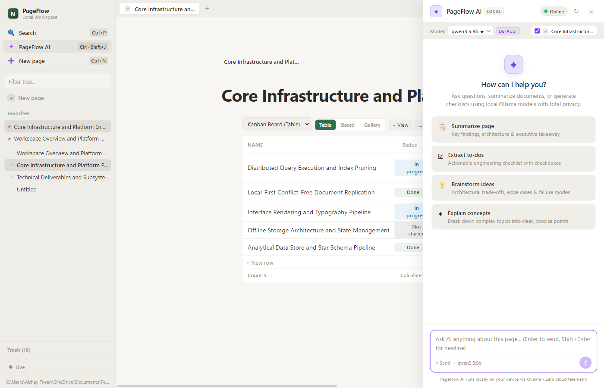

<p align="center">
  
</p>

<h1 align="center">PageFlow — Local-First Workspace with On-Device AI Engine</h1>

<p align="center">
  <strong>Fluid, private, distraction-free notes and databases. Zero cloud telemetry. Your workspace is a folder you own.</strong>
</p>

<p align="center">
  <a href="https://github.com/abhay-2108/PageFlow/releases"></a>
  <a href="https://github.com/abhay-2108/PageFlow/releases"></a>
  <a href="#tech-stack"></a>
  <a href="LICENSE"></a>
</p>

<p align="center">
  <a href="#architecture--philosophy"></a>
  <a href="#feature-highlights"></a>
  <a href="#setting-up-local-ai-ollama"></a>
  <a href="#overview"></a>
</p>

<p align="center">
  <b>⚡ 100% ZERO-CLOUD ARCHITECTURE • AIR-GAPPED & PRIVATE ⚡</b>
</p>

<p align="center">
  
  
  
  
  
</p>

---

The world's first open-source, local-first document and database platform modeled after Notion, engineered with high-performance **SQLite Write-Ahead Logging (WAL)**, **Yjs conflict-free replicated data types (CRDTs)**, and **zero-cloud on-device AI streaming via Ollama**. 

Author documents with instant sub-millisecond keyboard responsiveness, organize projects in Kanban boards and columnar data grids, and harness local language models like **DeepSeek-R1**, **Qwen 2.5**, or **Llama 3.2** directly on your hardware without leaking a single character to third-party cloud servers.

---

## Table of Contents

- [Visual Showcase](#visual-showcase)
- [Why Developers Choose PageFlow](#why-developers-choose-pageflow)
- [Architecture & Philosophy](#architecture--philosophy)
- [Feature Highlights](#feature-highlights)
  - [1. Rich Block-Based Document Editor](#1-rich-block-based-document-editor)
  - [2. Notion-Style Databases (Table, Board, Gallery, Calendar)](#2-notion-style-databases-table-board-gallery-calendar)
  - [3. Native On-Device AI Engine (Ollama)](#3-native-on-device-ai-engine-ollama)
  - [4. Local-First Storage & CRDT Sync](#4-local-first-storage--crdt-sync)
  - [5. Browser-Grade Multi-Tab Workspace](#5-browser-grade-multi-tab-workspace)
- [Keyboard Shortcuts](#keyboard-shortcuts)
- [Tech Stack](#tech-stack)
- [Getting Started](#getting-started)
  - [Prerequisites](#prerequisites)
  - [Installation & Development](#installation--development)
  - [Production Packaging](#production-packaging)
- [Setting Up Local AI (Ollama)](#setting-up-local-ai-ollama)
- [Data Storage & Backwards Compatibility](#data-storage--backwards-compatibility)
- [Testing & Quality Verification](#testing--quality-verification)
- [Contributing](#contributing)
- [License](#license)

---

## Visual Showcase

### 1. Rich Block Document Editor
*Smooth block-based authoring with slash commands (`/`), markdown quick inputs, resizable spreadsheet tables, and checklist blocks.*

<p align="center">
  
</p>

---

### 2. Notion-Style Databases & Kanban Board
*Dynamic columnar tables, drag-and-drop Kanban boards, gallery cards, and property filters backed by SQLite.*

<p align="center">
  
</p>

---

### 3. Native On-Device AI Assistant (`Ctrl+Shift+J`)
*Real-time token streaming, `<think>` intermediate reasoning trace accordions, and one-click page insertion powered by local Ollama models.*

<p align="center">
  
</p>

---

## Why Developers Choose PageFlow

| Dimension | Cloud SaaS (Notion) | File-Based (Obsidian) | **PageFlow** |
| :--- | :---: | :---: | :---: |
| **Data Ownership** | Proprietary cloud lock-in | Plain Markdown files | **Open SQLite WAL (`workspace.db`)** |
| **Document Speed** | Latency dependent on server | Instant | **Sub-millisecond ACID writes** |
| **Database Views** | Proprietary Cloud Engine | Plugin Dependent / Limited | **Native 4-View Engine (Table, Kanban, Gallery, Calendar)** |
| **Collaboration** | Centralized SaaS server | Paid subscription | **P2P WebRTC Mesh + Yjs CRDTs** |
| **AI Integration** | $10/mo cloud telemetry | Third-party community plugins | **Built-in First-Class Streaming + `<think>` Inspector** |
| **Multi-Tab Engine** | Electron webview wrapper | Tabs | **Browser-grade multi-tab bar (`Ctrl+T`)** |
| **Cloud Dependency** | 100% Tethered | 0% | **0% (100% Air-Gapped & Offline-First)** |
| **License** | Closed Source | Commercial licensing constraints | **MIT Permissive Open Source** |

---

## Architecture & Philosophy

1. **You Own Your Data**: All pages, databases, relations, and assets reside on your local drive in standard SQLite format (`workspace.db`). No accounts, no telemetry, no subscription paywalls, and no vendor lock-in.
2. **Instant Latency & Zero Spinners**: State changes write synchronously to an ACID-compliant local SQLite engine with WAL mode enabled. Reads and page traversals execute in sub-millisecond timeframes.
3. **Local-First AI Assistance**: Native integration with local LLM runtimes (Ollama). All prompt tokens, page contexts, and generated completions stream entirely on your CPU/GPU.
4. **Peer-to-Peer Collaboration**: Synchronize workspaces and collaborative edits over local networks or WebRTC meshes using Yjs CRDT algorithms without requiring a centralized SaaS cloud.

```
┌─────────────────────────────────────────────────────────────┐
│                        PageFlow Desktop                     │
│                                                             │
│  ┌───────────────────────┐       ┌───────────────────────┐  │
│  │     React 18 UI       │       │    TipTap / Prose     │  │
│  │   Multi-Tab Router    │       │     Block Editor      │  │
│  └───────────┬───────────┘       └───────────┬───────────┘  │
│              │                               │              │
│  ┌───────────▼───────────────────────────────▼───────────┐  │
│  │                  Preload Bridge (IPC)                 │  │
│  └───────────────────────────┬───────────────────────────┘  │
└──────────────────────────────┼──────────────────────────────┘
                               │
┌──────────────────────────────▼──────────────────────────────┐
│                    Electron Main Process                    │
│                                                             │
│   ┌────────────────────┐            ┌───────────────────┐   │
│   │   WorkspaceDb      │            │  Ollama AI Engine │   │
│   │ (better-sqlite3)   │            │ (HTTP Stream/SSE) │   │
│   │  WAL Mode + Schema │            │ Model Selector    │   │
│   └─────────┬──────────┘            └─────────┬─────────┘   │
└─────────────┼─────────────────────────────────┼─────────────┘
              │                                 │
     ┌────────▼────────┐               ┌────────▼────────┐
     │  Local Disk     │               │  Local Ollama   │
     │  workspace.db   │               │ 127.0.0.1:11434 │
     └─────────────────┘               └─────────────────┘
```

---

## Feature Highlights

### 1. Rich Block-Based Document Editor
- **ProseMirror & TipTap Foundation**: True block-based document model supporting headings, paragraphs, lists, quotes, callouts, and code blocks.
- **Slash Commands (`/`)**: Type `/` anywhere on a blank line to insert tables, bulleted lists, numbered lists, task checklists, callout boxes, or toggle blocks.
- **Interactive Checklist Blocks**: Native task lists with toggleable check states.
- **Embedded Resizable Tables**: Spreadsheet-like tables with add/remove column and row controls.
- **Markdown Quick Inputs**:
  - `# ` through `### ` for Level 1–3 Headings
  - `- ` or `* ` for Bulleted Lists
  - `[] ` for Task Lists
  - `> ` for Blockquotes and Callouts
  - ` ``` ` for Syntax-highlighted Code Blocks

### 2. Notion-Style Databases (Table, Board, Gallery, Calendar)
- **Four Layout Engines**:
  - **Table View**: Columnar data grid with cell editing, column resizing, and property aggregations.
  - **Board / Kanban View**: Drag-and-drop cards between customizable status columns.
  - **Gallery View**: Visual card grid ideal for asset catalogs, team directories, and research cards.
  - **Calendar View**: Chronological layout organizing cards by date property.
- **Rich Property Types**: Text, Number, Select, Multi-Select, Status, Date, Checkbox, Formula, and Cross-Database Relations.
- **Real-Time Formula Engine**: Evaluate dynamic calculations and text operations across record properties.
- **Multiple Named Views & Filters**: Create custom filtered, sorted, and grouped perspectives for any dataset.

### 3. Native On-Device AI Engine (Ollama)
- **Zero Cloud Leakage**: Connects directly to local models running via Ollama at `http://127.0.0.1:11434`.
- **Model Selector & Discovery**: Automatically detects all locally installed models (`deepseek-r1`, `qwen2.5`, `llama3.2`, `mistral`, etc.) and lets you hot-swap runtimes.
- **Real-Time Token Streaming**: Streams generated tokens instantaneously into the UI with smooth animations.
- **Reasoning Process Inspection (`<think>`)**: Collapsible thinking accordions reveal the model's intermediate reasoning trace without cluttering final outputs.
- **Inline Assistant (`Ctrl + J`)**: Select any text and trigger contextual actions:
  - Fix spelling & grammar
  - Summarize or condense
  - Translate or change tone
  - Extract action items and checklists
- **Persistent AI Chat Drawer (`Ctrl + Shift + J`)**: Full-page contextual workspace assistant capable of answering questions about your current document or generating new sections.
- **Direct Block Insertion**: Insert generated markdown, tables, or task lists directly into your current document with a single click.

### 4. Local-First Storage & CRDT Sync
- **SQLite Engine**: High-performance storage managed via `better-sqlite3` with Write-Ahead Logging (`WAL`) enabled.
- **Yjs CRDT Integration**: Document states are tracked as conflict-free replicated structures, enabling concurrent edits without collision or overwrite.
- **Peer-to-Peer WebRTC Mesh**: Connect to other PageFlow instances across local networks without central relays.
- **Offline Sync Bundles**: Export snapshot bundles (`.sync`) to transfer workspaces across machines air-gapped via USB or local storage.

### 5. Browser-Grade Multi-Tab Workspace
- **Browser-Grade Tab Bar**: Work across multiple pages and databases simultaneously.
- `Ctrl + T` to spawn new tabs, `Ctrl + W` to close tabs, and quick tab switching.

---

## Keyboard Shortcuts

| Shortcut | Context | Action |
| :--- | :--- | :--- |
| `Ctrl + T` | Global | Open a new workspace tab |
| `Ctrl + W` | Global | Close the active workspace tab |
| `Ctrl + P` / `Ctrl + K` | Global | Open Quick Find command palette |
| `Ctrl + J` | Editor | Open inline AI writing palette on selection |
| `Ctrl + Shift + J` | Global | Toggle contextual AI assistant side drawer |
| `/` | Empty Line | Open slash command palette for block insertion |
| `Ctrl + Z` | Editor | Undo last edit |
| `Ctrl + Shift + Z` | Editor | Redo edit |
| `Ctrl + B` | Text Selection | Toggle Bold formatting |
| `Ctrl + I` | Text Selection | Toggle Italic formatting |
| `Ctrl + U` | Text Selection | Toggle Underline formatting |
| `Ctrl + K` | Text Selection | Add or edit hyperlink |
| `Tab` | List Item / Table | Indent list item or advance to next table cell |
| `Shift + Tab` | List Item / Table | Outdent list item or move to previous table cell |

---

## Tech Stack

- **Runtime & Desktop Shell**: [Electron](https://www.electronjs.org/) 33
- **Frontend Framework**: [React](https://react.dev/) 18, [TypeScript](https://www.typescriptlang.org/) 5.7
- **Styling**: Tailored Modern CSS Design System (Dark & Light mode support)
- **Editor Engine**: [TipTap](https://tiptap.dev/) 2, [ProseMirror](https://prosemirror.net/)
- **Local Database**: [better-sqlite3](https://github.com/WiseLibs/better-sqlite3) (SQLite WAL Mode)
- **CRDT & Sync**: [Yjs](https://yjs.dev/), `y-prosemirror`, `y-webrtc`
- **AI Runtime**: [Ollama](https://ollama.ai/) (Local REST API streaming over `node:http`)
- **Build & Packaging**: [electron-vite](https://electron-vite.org/), [electron-builder](https://www.electron.build/)
- **Testing**: [Vitest](https://vitest.dev/), [Playwright](https://playwright.dev/)

---

## Getting Started

### Prerequisites

- **Node.js**: `v20.x` or `v22.x`
- **pnpm**: `v9.x` or later (`corepack enable && corepack prepare pnpm@latest --activate`)
- **Ollama** *(Optional, for AI features)*: Installed and running from [ollama.ai](https://ollama.ai/)

### Installation & Development

```bash
# Clone the repository
git clone https://github.com/abhay-2108/PageFlow.git
cd PageFlow

# Install project dependencies and native SQLite bindings
pnpm install

# Start the local Electron development window with hot module reloading (HMR)
pnpm dev

# (Optional) Seed the local workspace with sample pages, databases, and manuals
pnpm seed
```

### Production Packaging & Installers

```bash
# Run type checking across main, preload, and renderer packages
pnpm typecheck

# Run unit and integration tests
pnpm test

# Build both NSIS Installer and Portable .exe
pnpm dist

# (Alternatively) Build fast unpacked directory for testing
pnpm dist:dir
```

The resulting release artifacts are output to `dist-win/`:
- **`PageFlow-Setup-<version>.exe`**: Standard Windows installer with Start Menu shortcuts, Desktop icon, and uninstaller.
- **`PageFlow-<version>-portable.exe`**: Zero-install standalone executable for USB drives or quick testing.
- **`SHA256SUMS.txt`**: Cryptographic integrity checksums for verification.

---

## Setting Up Local AI (Ollama)

To enable on-device AI features in PageFlow:

1. Download and install [Ollama](https://ollama.ai/).
2. Pull a recommended model:
   ```bash
   # Balanced writing and general productivity (Recommended)
   ollama pull qwen2.5:7b

   # Lightweight model for ultra-fast responses
   ollama pull llama3.2:3b

   # Advanced reasoning and deep analysis
   ollama pull deepseek-r1:8b
   ```
3. Start the Ollama server:
   ```bash
   ollama serve
   ```
4. Open **PageFlow**. The model dropdown in the AI Assistant will automatically detect all downloaded models.

---

## Data Storage & Backwards Compatibility

PageFlow automatically locates or creates your workspace directory at:

- **Windows**: `%USERPROFILE%\Documents\PageFlow` *(or `%USERPROFILE%\OneDrive\Documents\PageFlow`)*
- **macOS / Linux**: `~/Documents/PageFlow`

### Backwards Compatibility
If you previously used an existing workspace folder (e.g. `Documents/NotionFlow` or `Documents/Pagegrove`), PageFlow automatically detects and reads your existing `workspace.db` without requiring manual migration.

### OneDrive & Cloud Sync WAL Protection
PageFlow's SQLite engine uses WAL (Write-Ahead Logging) configured with `busy_timeout = 5000ms`, `synchronous = NORMAL`, and memory-backed temporary tables. If your `Documents` directory is managed by Microsoft OneDrive, PageFlow automatically prevents lock timeouts and file contention during background syncs.

### Diagnostic Logs & Troubleshooting
If you encounter any unexpected issues, PageFlow maintains a rotating local log file:
- **Location**: `%APPDATA%\PageFlow\logs\app.log`
- **Quick Access**: Open Quick Find (`Ctrl + P` or `Ctrl + K`) and run **"Open Diagnostic Logs (app.log)"** to immediately open the log directory in File Explorer.

---

## Testing & Quality Verification

PageFlow is backed by a comprehensive suite of unit, integration, and end-to-end tests:

```bash
# Run unit tests (Formula engine, CRDT sync, AI system prompts, Markdown transformations)
pnpm test

# Run End-to-End tests via Playwright
pnpm test:e2e

# Run linter
pnpm lint
```

---

## Contributing

Contributions, issues, and feature requests are welcome!
Feel free to check the [issues page](https://github.com/abhay-2108/PageFlow/issues).

1. Fork the Project
2. Create your Feature Branch (`git checkout -b feature/AmazingFeature`)
3. Commit your Changes (`git commit -m 'feat: add some AmazingFeature'`)
4. Push to the Branch (`git push origin feature/AmazingFeature`)
5. Open a Pull Request

---

## License

This project is licensed under the [MIT License](LICENSE).
